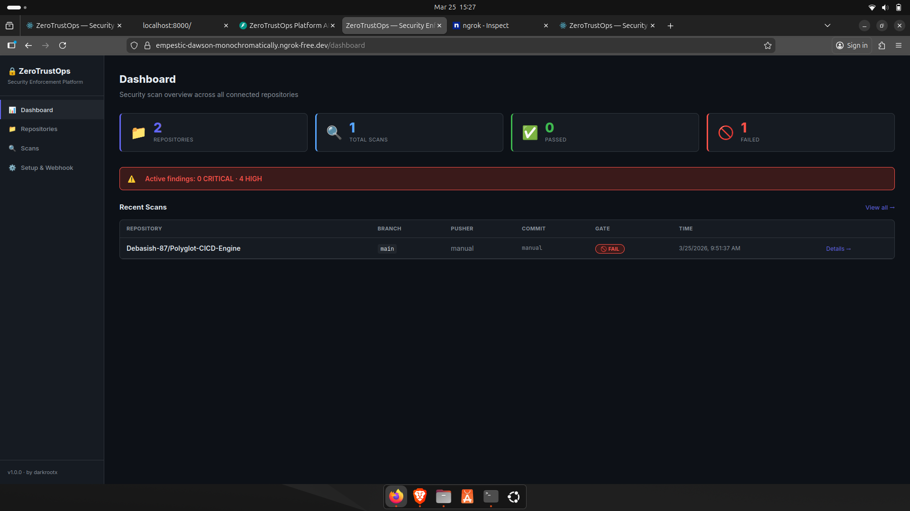
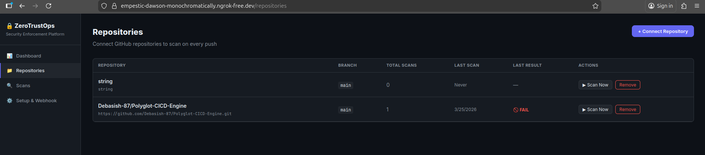
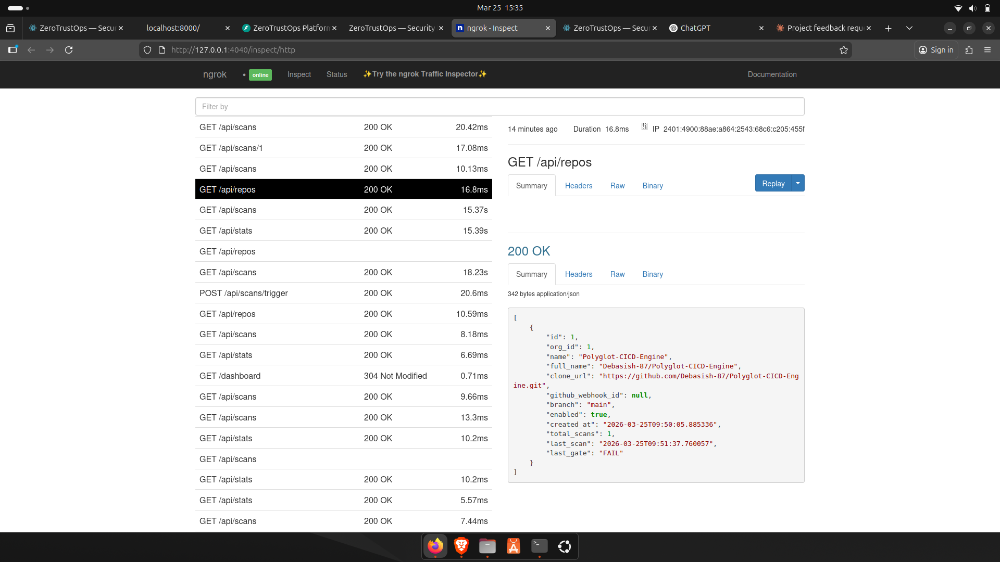
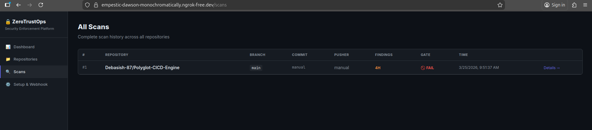
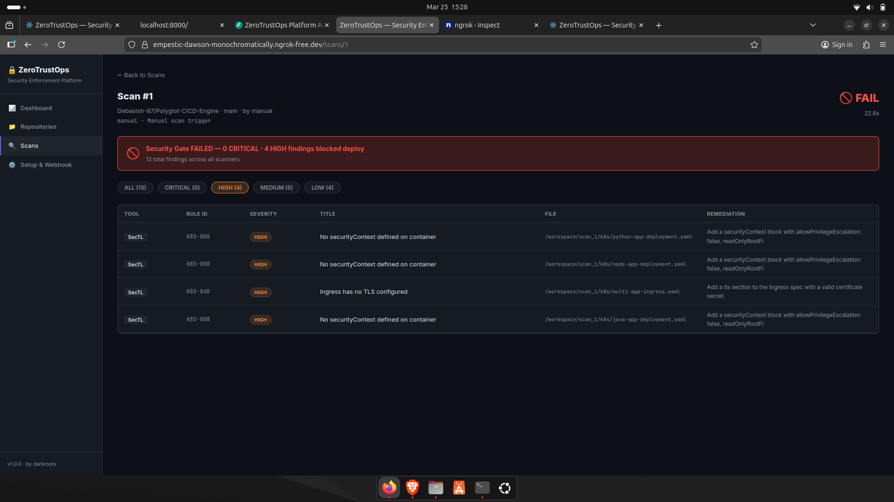
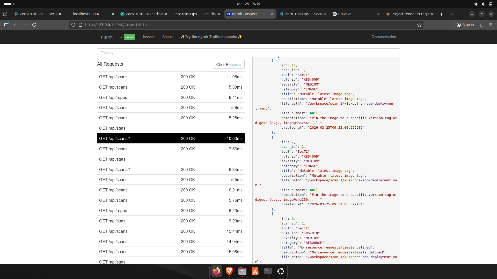
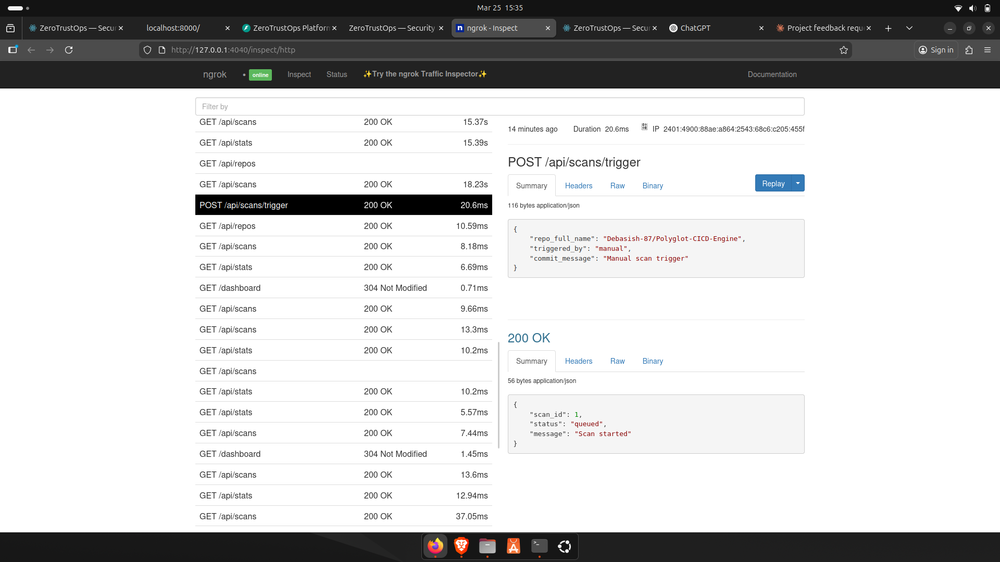
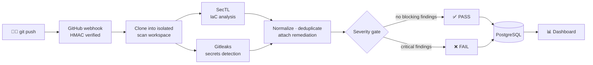

<div align="center">

# 🛡️ ZeroTrustOps Platform

### Every `git push` is a security checkpoint.

A self-hosted DevSecOps platform that scans each push for IaC misconfigurations and hardcoded secrets,<br/>
then returns a clear **PASS / FAIL** verdict before anything reaches production.

<br/>


<br/>

[**Quick Start**](#-quick-start) · [**Screenshots**](#-screenshots) · [**How It Works**](#-how-it-works) · [**SecTL CLI**](#-sectl--the-security-engine) · [**API**](#-rest-api) · [**Roadmap**](#-roadmap)

<br/>



</div>

---

## ✨ Highlights

<table>
<tr>
<td width="50%" valign="top">

### 🔍 Scan
- **70+ built-in rules** for Kubernetes, Terraform and Helm
- **Secrets detection** with Gitleaks (API keys, tokens, passwords)
- **Supply-chain checks**: `:latest` tags, unpinned digests, EOL images
- **Live AWS posture** audit (root keys, MFA, password policy, S3)

</td>
<td width="50%" valign="top">

### 🚦 Enforce
- **Binary PASS / FAIL gate** with severity thresholds
- **Kyverno admission policies** that block non-compliant workloads
- **SARIF / JSON output** for CI pipelines and GitHub Security
- **Remediation guidance** attached to every finding

</td>
</tr>
<tr>
<td width="50%" valign="top">

### ⚡ Automate
- **GitHub webhook** triggers a scan on every push
- **HMAC-signed deliveries**; invalid signatures are rejected
- **Manual trigger** from the dashboard or the REST API

</td>
<td width="50%" valign="top">

### 📊 Visualize
- **Real-time dashboard** of repositories and scan history
- **Severity breakdown** from CRITICAL to LOW
- **One command** to install: `bash setup.sh`

</td>
</tr>
</table>

---

## 📸 Screenshots

<table>
<tr>
<td align="center" width="50%">
<br/>
<b>Repository management</b><br/>
<sub>Add, remove and monitor repositories connected to the scan pipeline.</sub>
</td>
<td align="center" width="50%">
<br/>
<b>Per-repository summary</b><br/>
<sub>Status indicators and quick actions for each repository.</sub>
</td>
</tr>
<tr>
<td align="center" width="50%">
<br/>
<b>Scan history</b><br/>
<sub>PASS / FAIL status, timestamps and scan type for every run.</sub>
</td>
<td align="center" width="50%">
<br/>
<b>Scan summary</b><br/>
<sub>Findings grouped by severity, from CRITICAL to LOW.</sub>
</td>
</tr>
<tr>
<td align="center" width="50%">
<br/>
<b>Detailed findings</b><br/>
<sub>Rule ID, severity, file path, description and remediation.</sub>
</td>
<td align="center" width="50%">
<br/>
<b>Triggering a scan</b><br/>
<sub>Start a scan manually, or let the GitHub webhook do it on push.</sub>
</td>
</tr>
</table>

---

## 🔄 How It Works



If a push fails the security gate, it does not deploy.

---

## 🏗️ Architecture

| Component       | Technology        | Role                                                   |
|-----------------|-------------------|--------------------------------------------------------|
| **SecTL CLI**   | Go 1.21+          | Static analysis engine with 70+ built-in rules         |
| **Platform API**| Python · FastAPI  | Webhook receiver, scan orchestrator, REST API          |
| **Dashboard**   | React 18 · Vite   | Repository management and scan results                 |
| **Database**    | PostgreSQL 16     | Repositories, scans and findings                       |
| **Secrets**     | Gitleaks          | Hardcoded secret and credential detection              |

```
┌──────────────────────── Docker Compose network ────────────────────────┐
│                                                                        │
│   ┌──────────────┐       ┌──────────────┐       ┌──────────────┐       │
│   │   Dashboard  │ ◄───► │  FastAPI     │ ◄───► │ PostgreSQL   │       │
│   │   :3000      │       │  :8000       │       │ :5433        │       │
│   └──────────────┘       └──────┬───────┘       └──────────────┘       │
│                                 │                                      │
│                        ┌────────▼────────┐                             │
│                        │ SecTL + Gitleaks│                             │
│                        └─────────────────┘                             │
└────────────────────────────────▲───────────────────────────────────────┘
                                 │ GitHub webhook (via ngrok)
                           ┌─────┴─────┐
                           │  GitHub   │
                           └───────────┘
```

---

## 🚀 Quick Start

**Prerequisites:** Docker 24+ with Compose v2, Go 1.21+, Git.

```bash
git clone https://github.com/roudayn-kouka/ZeroTrustOps-Platform.git
cd ZeroTrustOps-Platform
bash setup.sh
```

`setup.sh` checks prerequisites, compiles `sectl`, generates a `.env` with random secrets, builds the containers and waits for health checks.

| Service        | URL                                                   |
|----------------|-------------------------------------------------------|
| Dashboard      | <http://localhost:3000>                               |
| API            | <http://localhost:8000>                               |
| Swagger docs   | <http://localhost:8000/docs>                          |

The dashboard asks for `PLATFORM_API_KEY` (from `.env`) at sign-in.

To remove everything (containers, volumes, images, networks and the `sectl` binary; source code is kept):

```bash
bash uninstall.sh
```

---

## 🧰 SecTL — the Security Engine

SecTL is a Go CLI that scans Infrastructure-as-Code and exits non-zero on findings, so it drops straight into any CI pipeline.

### Scan types

| Type           | Target                 | Coverage                                                          |
|----------------|------------------------|-------------------------------------------------------------------|
| `k8s`          | Kubernetes manifests   | Pods, Deployments, RBAC, Ingress, ConfigMaps, ServiceAccounts     |
| `terraform`    | Infrastructure as Code | AWS, GCP, Azure: S3, IAM, Security Groups, RDS, EKS, CloudTrail   |
| `helm`         | Helm charts            | `Chart.yaml`, `values.yaml`, rendered templates                   |
| `posture`      | Live AWS account       | IAM root keys, MFA, password policy, S3 posture                   |
| `supply-chain` | Container images       | Digest pinning, `:latest` detection, EOL base images              |

### Usage

```bash
sectl scan ./manifests --type k8s                                   # Kubernetes
sectl scan ./infra --type terraform --severity high --fail-on-findings  # CI gate
sectl scan ./charts/myapp --type helm                               # Helm
sectl verify nginx:latest myapp:1.0.0                               # Supply chain
sectl audit --provider aws --region us-east-1                       # AWS posture
sectl scan ./manifests --type k8s --output sarif                    # SARIF / json / table
sectl rules --source k8s --severity critical                        # List rules
```

<details>
<summary><b>Sample critical and high rules</b></summary>

<br/>

| Rule ID      | Severity    | Description                                            |
|--------------|-------------|--------------------------------------------------------|
| `K8S-001`    | 🔴 CRITICAL | `hostPID` enabled: container sees all host processes   |
| `K8S-004`    | 🔴 CRITICAL | Privileged container: full host device access          |
| `K8S-020`    | 🔴 CRITICAL | RBAC wildcard `apiGroups` (`*`)                        |
| `K8S-024`    | 🔴 CRITICAL | Binding to `cluster-admin` role                        |
| `K8S-025`    | 🔴 CRITICAL | Binding to an unauthenticated or anonymous subject     |
| `K8S-005`    | 🟠 HIGH     | `allowPrivilegeEscalation` not set to `false`          |
| `K8S-031`    | 🟠 HIGH     | Hardcoded secret in an environment variable            |
| `TF-S3-010`  | 🔴 CRITICAL | S3 bucket ACL set to public                            |
| `TF-IAM-001` | 🔴 CRITICAL | IAM policy allows `Action: *`                          |
| `TF-SG-001`  | 🔴 CRITICAL | Sensitive port open to the internet                    |
| `TF-RDS-002` | 🔴 CRITICAL | RDS instance publicly accessible                       |
| `TF-EKS-002` | 🟠 HIGH     | EKS API server publicly accessible                     |

Run `sectl rules` for the full list.

</details>

---

## 🔗 GitHub Webhook

```bash
ngrok http 3000
```

In your repository, open **Settings → Webhooks → Add webhook**:

| Field        | Value                                          |
|--------------|------------------------------------------------|
| Payload URL  | `https://<your-ngrok-url>/webhook/github`      |
| Content type | `application/json`                             |
| Secret       | `GITHUB_WEBHOOK_SECRET` from `.env`            |
| Events       | Push events                                    |

Every following `git push` triggers a full scan.

---

## 📡 REST API

| Method   | Endpoint              | Description                       | Auth     |
|----------|-----------------------|-----------------------------------|----------|
| `GET`    | `/health`             | Health check                      | —        |
| `GET`    | `/api/stats`          | Dashboard counters                | API key  |
| `GET`    | `/api/repos`          | List repositories                 | API key  |
| `POST`   | `/api/repos`          | Add a repository                  | API key  |
| `DELETE` | `/api/repos/{id}`     | Remove a repository               | API key  |
| `GET`    | `/api/scans`          | List recent scans                 | API key  |
| `GET`    | `/api/scans/{id}`     | Scan detail with findings         | API key  |
| `POST`   | `/api/scans/trigger`  | Trigger a scan                    | API key  |
| `POST`   | `/webhook/github`     | GitHub push receiver              | HMAC     |

```bash
# Trigger a scan
curl -X POST http://localhost:8000/api/scans/trigger \
  -H "X-API-Key: $PLATFORM_API_KEY" -H "Content-Type: application/json" \
  -d '{"repo_full_name": "owner/repo"}'

# Critical findings of scan 42
curl -H "X-API-Key: $PLATFORM_API_KEY" http://localhost:8000/api/scans/42 \
  | jq '.findings[] | select(.severity == "CRITICAL")'
```

---

## ☸️ Kyverno Admission Policies

Three cluster-wide policies in `Enforce` mode block non-compliant resources at admission time.

| Policy                    | Blocks                                                             |
|---------------------------|--------------------------------------------------------------------|
| `disallow-latest-tag`     | Containers using `:latest` or untagged images                      |
| `disallow-privileged`     | Privileged containers, privilege escalation, host namespaces       |
| `require-resource-limits` | Containers without CPU and memory requests and limits              |

```bash
kubectl apply -f manifests/kyverno-policies/
kubectl get clusterpolicy
```

---

## ⚙️ Configuration

`setup.sh` generates `.env` on first run. For a manual setup, copy `.env.example` to `.env` and replace every placeholder with a random value of at least 32 characters:

```env
POSTGRES_USER=zerotrust
POSTGRES_DB=zerotrust
POSTGRES_PASSWORD=<random-secret>
PLATFORM_API_KEY=<random-secret>
GITHUB_WEBHOOK_SECRET=<random-secret>
```

All ports bind to `127.0.0.1` only: dashboard `3000`, API `8000`, PostgreSQL `5433` (to avoid clashing with a local instance). Use HTTPS when exposing the dashboard remotely.

<details>
<summary><b>Database schema</b></summary>

<br/>

```
organizations └── repositories └── scans └── findings
```

| Field         | Description                                 |
|---------------|---------------------------------------------|
| `tool`        | `sectl` or `gitleaks`                       |
| `rule_id`     | e.g. `K8S-001`, `TF-IAM-001`                |
| `severity`    | `CRITICAL`, `HIGH`, `MEDIUM`, `LOW`         |
| `category`    | e.g. `rbac`, `network`, `secrets`           |
| `title`       | Short rule description                      |
| `description` | Full explanation of the violation           |
| `file_path`   | Path of the affected file                   |
| `remediation` | How to fix it                               |

</details>

---

## 🧪 Tests

```bash
# SecTL unit tests
cd sectl && go test -race ./...

# API security tests
pip install -r platform/api/requirements.txt
python -m unittest discover -s platform/api/tests

# Try SecTL on the bundled fixtures (bad-* files trigger rules, good-* files are clean)
sectl scan ./sectl/testdata/k8s --type k8s
sectl scan ./sectl/testdata/terraform --type terraform
```

---

## 📁 Project Structure

```
ZeroTrustOps-Platform/
├── setup.sh · uninstall.sh · docker-compose.yml
├── sectl/                    # Go security CLI
│   ├── cmd/                  #   scan, audit, verify, rules
│   ├── internal/
│   │   ├── scanner/          #   K8s, Terraform, Helm analyzers + tests
│   │   ├── posture/          #   live AWS audit
│   │   ├── supply/           #   container supply-chain checks
│   │   └── report/           #   table, JSON, SARIF renderers
│   └── testdata/             #   good / bad fixtures
├── platform/
│   ├── api/                  # FastAPI backend + tests
│   ├── web/                  # React dashboard (Vite, served by nginx)
│   └── db/init.sql           # PostgreSQL schema
├── manifests/
│   ├── dev/                  # hardened Kubernetes deployment example
│   └── kyverno-policies/     # admission control policies
├── docs/                     # static project site
└── screenshots/
```

The static site in `docs/` can be published with the **Deploy Docs Site** workflow. It only runs manually: enable GitHub Pages (**Settings → Pages → Source: GitHub Actions**), then click **Run workflow** in the Actions tab.

---

## 🗺️ Roadmap

- [ ] Report PASS / FAIL on pull requests through the commit status API
- [ ] Slack and Microsoft Teams notifications
- [ ] Trivy image vulnerability scanning
- [ ] Falco runtime threat detection
- [ ] SARIF upload to GitHub Advanced Security
- [ ] Multi-organization support and RBAC
- [ ] Prometheus `/metrics` endpoint
- [ ] GitLab webhook support

---

## 🤝 Contributing

1. Fork the repository and create a branch: `git checkout -b feature/my-new-rule`
2. Add your rule in `sectl/internal/scanner/` (each rule needs a `RuleID`, `Severity`, `Title`, `Description` and `Remediation`)
3. Add a test in the matching `_test.go` file and fixtures in `sectl/testdata/`
4. Run `go test ./...` and open a pull request

---

<div align="center">

Distributed under the [MIT License](LICENSE).

Made by **Roudayna Kouka** · [github.com/roudayn-kouka](https://github.com/roudayn-kouka)

</div>
